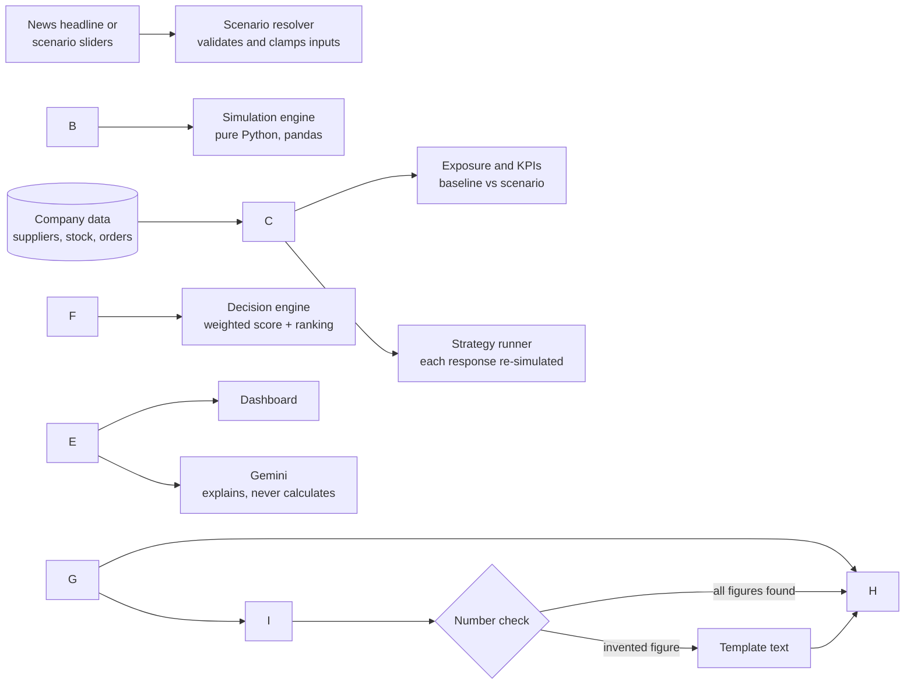

# ShockPoint ⚡

**Know where a world event hits your business, and what to do about it.**

!\[Python](https://img.shields.io/badge/Python-3.11%20to%203.13-3776AB?logo=python\&logoColor=white)
!\[FastAPI](https://img.shields.io/badge/FastAPI-backend-009688?logo=fastapi\&logoColor=white)
!\[Gemini](https://img.shields.io/badge/Google%20Gemini-explanations-4285F4?logo=googlegemini\&logoColor=white)
!\[Tests](https://img.shields.io/badge/tests-32%20passing-2ea44f)
!\[Cost](https://img.shields.io/badge/running%20cost-RM%200-success)

ShockPoint is a decision-support system for manufacturers. When a port closes or demand collapses somewhere in the world, it shows how that event hits **one specific company**: which parts run out and on which day, which customer orders are lost, and what happens to margin and cash. It then compares the possible responses and recommends one. Every number traces back to a formula, an input and a source.

```
Global event  →  Business exposure  →  Impact simulation  →  Strategy comparison  →  Decision
```

**Live demo:** `https://shockpoint.onrender.com/` (the free server sleeps after 15 idle minutes, so the first load can take about a minute)

Built for the **APU Cloud Innovation Hackathon 2026**, Track 03: *Data-Driven Research \& Intelligent Decision Making*.

> \*\*Simulated data.\*\* The demo company (\*Mutiara Control Systems Sdn Bhd\*, Penang) and all of its suppliers, orders and events are synthetic. Only the USD/MYR exchange rate and the LME copper price are real; their sources are cited in `data/assumptions.csv` and in the app's Assumptions panel.

\---

## Contents

* [The problem](#the-problem)
* [What ShockPoint does](#what-shockpoint-does)
* [How it works](#how-it-works)
* [Tech stack](#tech-stack)
* [Requirements](#requirements)
* [Quick start](#quick-start)
* [Configuration](#configuration)
* [A 2-minute tour](#a-2-minute-tour)
* [Scenarios and results](#scenarios-and-results)
* [The decision engine](#the-decision-engine)
* [AI and its guardrails](#ai-and-its-guardrails)
* [Data](#data)
* [API](#api)
* [Project structure](#project-structure)
* [Testing](#testing)
* [Deployment](#deployment)
* [Limitations and roadmap](#limitations-and-roadmap)
* [Credits](#credits)

\---

## The problem

A typhoon closes a port in China. The news reports the typhoon, but a factory in Penang still has to work out for itself:

* which of its parts come through that port, and how many days of stock it has left;
* on which day the production line stops;
* which customer orders, worth how much, will miss their due date;
* whether to buy from another supplier, air-freight parts, raise prices, or do nothing.

Small and mid-size manufacturers usually answer these questions with spreadsheets, after the line has already stopped. ShockPoint answers them in seconds, before it does.

## What ShockPoint does

|Page|What you get|
|-|-|
|**Overview**|One-glance status: an alert banner, an impact map of suppliers, ports and trade lanes, five KPI cards (baseline vs scenario), the top recommendation, and an AI executive briefing.|
|**Scenario Simulator**|Sliders for each shock (place, severity, duration, freight cost, demand drop, prices, ringgit), plus **Event to scenario**: paste a news headline and the matching scenario is set up for you.|
|**Business Exposure**|Which suppliers, materials, products and customer orders a shock touches, how dependent the company is on each country, and when each material runs out.|
|**Decision Engine**|Every response run through the same simulation and ranked by a transparent weighted score. You set the weights; *Do nothing* is always shown as the cost of inaction.|
|**Live Monitor**|A feed of headlines, each mapped to a scenario and run automatically. Choose the **demo feed** or **real headlines** from the past week (GDELT).|
|**Ask ShockPoint**|A chat panel (bottom right) that answers questions using only the current results.|

Every KPI card has an **i** button that shows its formula, its inputs and where they come from. The layout works on laptops, tablets and phones.

## How it works



Three rules hold everywhere:

1. **The engine decides.** `engine/` is plain Python with no web framework and no AI. Every number comes from it.
2. **The AI explains.** Gemini turns headlines into scenario settings and writes briefings. It never produces a figure that the engine did not, and a server-side check enforces this.
3. **The frontend only displays.** The browser never calculates; it renders what the API returns.

## Tech stack

|Layer|Technology|
|-|-|
|Engine|Python 3.11+, pandas, NumPy|
|API|FastAPI, Uvicorn, Pydantic|
|AI|Google Gemini (`google-genai`), Flash models; optional Grok/Groq backup|
|Frontend|HTML, CSS and vanilla JavaScript; Apache ECharts (charts), MapLibre GL with OpenFreeMap tiles (map), Lucide (icons), Inter (font)|
|Real news|GDELT DOC 2.0 API (free, no key)|
|Data|Synthetic CSV/JSON generated by `scripts/generate\_data.py` (Faker, fixed seed)|
|Tests|pytest, 32 tests with hand-checked expected values|
|Hosting|Docker, Render free web service|

Everything above is free to use. The running cost of the deployed app is RM 0.

## Requirements

* **Python 3.11, 3.12 or 3.13** ([python.org](https://www.python.org/downloads/); on Windows tick *Add Python to PATH*).
* **A modern browser** (Chrome, Edge, Firefox, Safari) with internet access, because the charts, map and icons load from public CDNs.
* **A Gemini API key** (optional, free) from [Google AI Studio](https://aistudio.google.com/apikey). Without one, the app still works and shows template text instead of AI text.
* **Docker** (optional), only if you want to run the container locally.

Python packages are pinned in `requirements.txt`:

|Package|Version|Used for|
|-|-|-|
|fastapi|0.162.4|API routes and serving the frontend|
|uvicorn\[standard]|0.54.0|Web server|
|pandas|3.1.1|Data tables in the engine|
|numpy|2.4.6|Maths in the engine and data generator|
|pydantic|2.14.3|Request and response validation|
|google-genai|3.1.0|Gemini client|
|python-dotenv|1.2.4|Reading `.env`|
|Faker|40.54.0|Synthetic names in the data generator|
|httpx|0.28.1|GDELT and backup-AI calls; test client|
|pytest|9.2.0|Tests|

## Quick start

### Windows (Command Prompt)

```bat
cd path\\to\\shockpoint
python -m venv .venv
.venv\\Scripts\\activate.bat
pip install -r requirements.txt
copy .env.example .env
notepad .env
python scripts\\generate\_data.py
uvicorn backend.main:app --reload --port 8000
```

In PowerShell, activate with `.venv\\Scripts\\Activate.ps1` instead.

### macOS / Linux

```bash
cd path/to/shockpoint
python3 -m venv .venv
source .venv/bin/activate
pip install -r requirements.txt
cp .env.example .env        # then open .env and paste your key
python scripts/generate\_data.py
uvicorn backend.main:app --reload --port 8000
```

Then open **http://localhost:8000**. Interactive API docs are at http://localhost:8000/docs.

To stop the server, press `Ctrl+C`. Next time you only need to activate the virtual environment and run the `uvicorn` line.

### With Docker

```bash
docker build -t shockpoint .
docker run -p 7860:7860 --env-file .env shockpoint
```

Then open http://localhost:7860.

## Configuration

Settings live in `.env` (copied from `.env.example`). Never commit `.env`; it is already in `.gitignore`.

|Variable|Required|Default|What it does|
|-|-|-|-|
|`GEMINI\_API\_KEY`|No|none|Turns on AI briefings, headline reading and Ask ShockPoint.|
|`GEMINI\_MODEL`|No|`gemini-3.8-flash`|Main model. If it is busy or retired, the app tries other available Flash models automatically.|
|`GEMINI\_FALLBACK\_MODELS`|No|auto|Comma-separated list to override the automatic backup models.|
|`GROK\_API\_KEY`|No|none|Optional second AI used only when Gemini fails: an xAI key (`xai-…`) or a Groq key (`gsk\_…`).|
|`PORT`|No|`7860` in Docker|Port the container listens on (hosts such as Render set it).|

**Stable numbers.** The engine treats the date stored in `data/meta.json` as "today", so every result stays the same until the data is regenerated. To pick the date yourself:

```bash
python scripts/generate\_data.py --as-of 2026-11-13
```

## A 2-minute tour

1. Open **Overview** with *Baseline (no shock)* selected: everything is calm.
2. In the top dropdown pick **China: Yantian Port (Shenzhen)**. The banner turns red: production stops in 16 days, RM 610k of orders are at risk, and the top recommendation is to buy early from a Korean supplier.
3. Pick **Malaysia: Penang Port (our import port)**. All 8 suppliers are hit, and the advice changes to air freight, because every alternative supplier also ships through Penang.
4. Pick **Global electronics demand slump**. The problem flips to excess stock, and so does the advice: cut purchase orders.
5. Open **Decision Engine** and move the weight sliders to see how the ranking responds.
6. Open **Scenario Simulator**, paste `Typhoon halts Yantian port for three weeks; freight rates up 80%` into *Event to scenario*, and see each setting with the words that set it.

## Scenarios and results

### S1 · Port closure / shipping disruption (supply shock)

**Inputs:** affected place, severity (% of capacity lost), duration (days), freight cost increase (%).

The place is one of the company's supplier countries (China, Taiwan, South Korea, Japan, Vietnam) or **Malaysia: Penang Port**, where every import lands. The banner title, map and historical precedent follow the place you choose.

Results with the default inputs (85% severity, 14 days, freight +60%):

|Place|Suppliers hit|Production stops?|Top response|
|-|-|-|-|
|China (Yantian Port)|4 of 8, 50% of spend|Yes, power management IC on day 16|Buy early from Changwon Power Devices (South Korea)|
|Taiwan, South Korea, Japan, Vietnam|1 of 8 each|No, stock covers the delay|Do nothing|
|Malaysia (Penang Port)|8 of 8|Yes, power management IC on day 16|Air-freight critical parts|

For the China case: 5 orders worth **RM 610k** are at risk, gross margin falls from **22.9% to 18.1%**, and the top response *"costs RM 9k now plus RM 2k over the horizon, protects RM 610k of orders, and arrives 7 days before stockout."*

The responses adapt to the place. *Buy early* and *Switch volume* pick the fastest alternative supplier outside the closed area and are named after it. If every alternative ships through the closed port, they score zero and the app says why.

**Historical precedents** (behind the **i** next to the banner title): COVID shutdowns at Yantian, China (2021); Typhoon Krathon at Kaohsiung, Taiwan (Oct 2024); Typhoon Hinnamnor at Busan, South Korea (Sep 2022); Typhoon Jebi at Kobe, Japan (Sep 2018); Super Typhoon Yagi at Hai Phong, Vietnam (Sep 2024). Penang Port has no full closure on record, so the app says so and cites the nearest case (monsoon floods around Port Klang, Nov 2025).

### S2 · Global electronics demand slump (demand shock)

**Inputs:** demand drop (%), input price change (%), ringgit vs USD change (%), supplier failure risk (%).

Results with the defaults (orders down 25%): excess inventory reaches **RM 547k**, cash ends **RM 1.27M** below plan, margin falls from **22.9% to 9.5%**, and the two weakest suppliers are flagged. The top response is **Cut purchase orders**, which frees **RM 483k** of cash.

Same engine, opposite advice: secure supply in a supply shock, hold back and protect cash in a demand shock.

### Live Monitor

* **Demo feed** (default): 6 timestamped headlines in `data/events\_feed.json`. Always available.
* **Real headlines:** news from the past 7 days via the free GDELT DOC 2.0 API ([gdeltproject.org](https://www.gdeltproject.org/)). Each headline goes through the same rules as *Event to scenario*; only those that match a modelled shock are kept, with a link to the article. Results are cached for 30 minutes. If GDELT is unreachable or nothing fits, the app shows the demo feed and says why.

## The decision engine

Each response is run through the same simulation as the shock itself, then scored on four criteria:

|Criterion|Measured as|Default weight|
|-|-|-|
|Value protected|Extra gross profit vs doing nothing (RM), after the response's own costs|40%|
|Cost|Upfront + ongoing cost of the response (RM), lower is better|25%|
|Cash impact|Cash position after the response (RM), higher is better|20%|
|Feasibility|Arrival time vs the stockout date, and supplier capacity (0 to 1)|15%|

```
Score(s) = Σ  weight(c) × normalised(c, s)
```

Each criterion is min-max scaled from 0 to 1 across the responses, and the weights (set with sliders in the app) are normalised to sum to 1. *Do nothing* is always included, so the cost of inaction is visible.

### KPI formulas

|KPI|Formula|Used in|
|-|-|-|
|Inventory runway (days)|stock on hand ÷ daily usage, per material|S1|
|Supply gap (days)|new lead time − runway; production stops if > 0|S1|
|Production stop date|data date + runway, when new lead time > runway|S1|
|Cost impact (RM)|affected units × unit cost × price increase % + extra freight|S1, S2|
|Gross margin (%)|(revenue − cost of goods) ÷ revenue|S1, S2|
|Revenue at risk (RM)|orders due inside the supply-gap window (S1), or cancelled by the demand drop (S2)|S1, S2|
|Cash position (RM)|projected cash − cost impact − upfront cost of the response|S1, S2|
|Excess inventory (RM)|(stock + open orders − reduced usage × horizon) × unit cost, if positive|S2|
|Business risk|Low / Medium / High from thresholds on margin drop and revenue at risk|S1, S2|

Key inputs: new lead time = supplier lead time + duration × severity; extra freight = affected value × 8% freight share × freight increase; the analysis horizon is 60 days. All other assumptions, with their sources, are in `data/assumptions.csv`.

## AI and its guardrails

Gemini does three jobs: it turns a headline into scenario settings, writes the executive briefing, and answers questions in Ask ShockPoint. It never calculates or ranks.

* **Grounded prompts.** Gemini receives only the engine's results, already formatted (e.g. "RM 610k", "18.1%"), and is told to copy numbers exactly.
* **Number check.** A server-side check finds every RM amount and percentage in the AI's text. If any is not in the results, the AI text is discarded and the engine's own template text is shown instead.
* **Structured headline reading.** Headlines are parsed into a fixed JSON schema. Each value comes with the headline words that justify it; anything the headline does not mention keeps its default; values are clamped to the slider ranges; headlines outside the two modelled shocks are rejected with a reason.
* **Clear labels.** AI text is labelled *AI-generated summary* with the model that answered; fallback text is labelled *Template summary (AI unavailable)*.
* **Resilience.** If the main model is busy (503/504) or missing (404), the app tries other Flash models, then the optional backup AI, then the template.
* **Privacy.** Only synthetic data is ever sent to the AI. The API key lives on the server, never in the browser or the repository.

## Data

All company data is generated by `scripts/generate\_data.py` with a fixed seed (42), so every run produces the same numbers.

|File|Contents|
|-|-|
|`company.csv`|The company: name, industry, city, cash, fixed costs, USD revenue share|
|`materials.csv`|6 materials: stock, daily usage, safety stock, criticality|
|`suppliers.csv`|8 current + 4 alternative suppliers. Spend: China 50%, Taiwan 21%, South Korea 12%, Japan 9%, Vietnam 8%; every sea route lands at Penang Port|
|`products.csv`|3 products with prices and monthly volumes|
|`bom.csv`|11 bill-of-materials rows|
|`orders.csv`|28 customer orders due in the next 60 days (MYR and USD)|
|`scenarios.json`|The 2 scenarios, their inputs, ranges, ports and precedents|
|`strategies.json`|4 responses per scenario + *Do nothing*|
|`assumptions.csv`|20 assumptions, each with its source|
|`events\_feed.json`|6 demo headlines for Live Monitor|
|`meta.json`|The data date the engine uses as "today"|

## API

|Route|Purpose|
|-|-|
|`GET /api/health`|Health check: data loaded, data date, whether an AI key is set (never the key)|
|`GET /api/baseline`|Company, baseline KPIs, scenarios, strategies, assumptions, supplier exposure|
|`POST /api/simulate`|`{scenario\_id, drivers}` → baseline vs scenario KPIs, exposure, banner|
|`POST /api/decide`|`{scenario\_id, drivers, weights}` → ranked responses and the recommendation|
|`GET /api/events?source=demo\|live`|Live Monitor feed: demo events or real GDELT headlines (falls back to demo)|
|`POST /api/ai/brief`|Executive briefing from the current results|
|`POST /api/ai/parse-event`|Headline → scenario settings, with the words behind each value|
|`POST /api/ai/ask`|Short answer to a question, grounded in the current results|

Full request and response schemas: `/docs` (Swagger UI) on any running instance.

## Project structure

```
shockpoint/
├── backend/
│   ├── main.py          API routes; serves the frontend
│   ├── ai.py            All AI calls, prompts, model fallback, number check
│   ├── news.py          Real headlines from GDELT (cached)
│   └── schemas.py       Pydantic request/response models
├── engine/              Pure Python: no web framework, no AI
│   ├── loader.py        Reads /data; the data date
│   ├── simulate.py      Scenario resolver and the simulation (KPIs)
│   ├── exposure.py      Suppliers, materials and orders a shock touches
│   ├── strategies.py    Runs each response through the simulation
│   ├── decide.py        Weighted scoring, ranking, explanations
│   └── event\_source.py  Demo feed and headline → settings mapping
├── frontend/
│   ├── index.html       Single-page dashboard
│   ├── favicon.svg      Browser-tab icon
│   ├── css/theme.css    Dark theme; laptop, tablet and phone layouts
│   ├── js/              app, api, overview, simulator, exposure, decision, monitor, charts, map
│   └── data/world.json  Offline map used if the tile server is unreachable
├── data/                Generated CSV + JSON (see Data)
├── scripts/
│   └── generate\_data.py Builds /data from a fixed seed
├── tests/
│   └── test\_engine.py   32 tests
├── Dockerfile           One container: API + frontend
├── requirements.txt     Pinned Python packages
└── .env.example         Template for your local .env
```

## Testing

```bash
pytest
```

The 32 tests cover every KPI formula against values worked out by hand from the CSV files, the 50/30/20 supply split, the decision scoring and weight changes, the opposite advice for the two shocks, every supply place including Penang Port, the API routes, the AI fallback without a key, the number check, headline parsing and rejection, the real-headline feed and its fallback, and the UI wording rules.

## Deployment

The app runs as a single Docker container that serves both the API and the frontend.

**Render (free):**

1. Push the project to a public GitHub repository (without `.env` or `.venv`).
2. On [render.com](https://render.com): **New → Web Service**, connect the repository.
3. Language **Docker**, region **Singapore**, instance type **Free**. Leave build and start commands empty.
4. Add environment variables `GEMINI\_API\_KEY` and `GEMINI\_MODEL=gemini-3.8-flash`.
5. Optional: set the health check path to `/api/health`.
6. Deploy. The first build takes about 5 to 8 minutes.

Notes:

* The free service sleeps after 15 minutes without visits and takes about a minute to wake. Open the link shortly before a demo.
* Each build re-runs the data generator, so order due dates move to the build day; the values themselves never change.
* The same `Dockerfile` runs on any Docker host, for example Google Cloud Run: `gcloud run deploy shockpoint --source .`

## Limitations and roadmap

**Current limitations**

* Company data is simulated; the model covers one plant, 6 materials and 8 suppliers.
* Two shock types: supply (port closure or shipping disruption) and demand (electronics slump).
* Real headlines are matched with keyword rules; relevant port-closure news in the supplier countries is rare, so the demo feed is the default.

**Roadmap**

* Import a real company's ERP export (same CSV format) instead of the generator.
* More shock types: input-cost spikes, currency shocks, export restrictions.
* Several plants and multi-tier suppliers.
* Alerts when a monitored headline crosses a risk threshold.

**Out of scope:** stock-market prediction, login and user accounts, a global supplier database, machine-learning forecasting.

## Credits

* Map: [MapLibre GL JS](https://maplibre.org/) (BSD-3), tiles by [OpenFreeMap](https://openfreemap.org/), map data © [OpenStreetMap](https://www.openstreetmap.org/copyright) contributors; offline outlines from [Natural Earth](https://www.naturalearthdata.com/) (public domain).
* Charts: [Apache ECharts](https://echarts.apache.org/) (Apache 2.0). Icons: [Lucide](https://lucide.dev/) (ISC). Font: [Inter](https://rsms.me/inter/) (OFL).
* News: [The GDELT Project](https://www.gdeltproject.org/).
* AI: [Google Gemini](https://ai.google.dev/).
* Market data: USD/MYR rate from Trading Economics; LME copper price as cited in `data/assumptions.csv`.

